# miditin 1 — User Manual

miditin 1 is a generative MIDI processor. You play notes into it and it plays notes back out,
but not the same ones. Each held note starts a small machine running: a slowly moving **energy**
drives a **pulse** maker (a spinning wheel, a box of bouncing balls, a beat grid, or your own
playing), each pulse steps a **generator** (an arpeggio or a 16-step melody), and a **transform**
turns the generator's steps into real notes, in a scale or on the notes you hold.

Nothing comes out while no note is held. Lift your hands and it stops. It makes no sound itself
(apart from an optional preview synth), so you put a synth after it.

**Contents**

1. [Getting started](#1-getting-started)
2. [The window at a glance](#2-the-window-at-a-glance)
3. [How the chain works](#3-how-the-chain-works)
4. [Header](#4-header)
5. [ENERGY](#5-energy)
6. [PULSE](#6-pulse)
7. [GENERATE](#7-generate)
8. [TRANSFORM](#8-transform)
9. [IN and OUT](#9-in-and-out)
10. [Mono and poly](#10-mono-and-poly)
11. [Presets](#11-presets)
12. [Recipes](#12-recipes)
13. [Tips and troubleshooting](#13-tips-and-troubleshooting)
14. [Automation reference](#14-automation-reference)

---

## 1. Getting started

**Set it up.** miditin 1 comes as a VST3 and as a standalone app.

- **In a DAW:** VST3 has no "MIDI effect" category, so miditin 1 shows up as an *instrument*
  with a MIDI output. Put it on a track that receives your MIDI controller, then route that
  track's MIDI output to a second track with a synth on it. In REAPER: track 1 has miditin 1 and
  is armed for your keyboard; track 2 has the synth and a MIDI-only send from track 1.
- **Standalone:** pick a MIDI input and a MIDI output device in its audio/MIDI settings. Or turn
  on **SOUND** in the header to hear the built-in preview synth without any routing.

**Play.** Hold a chord: on your controller, or by clicking keys on the **IN** keyboard (a click
latches a key, a second click lets it go).

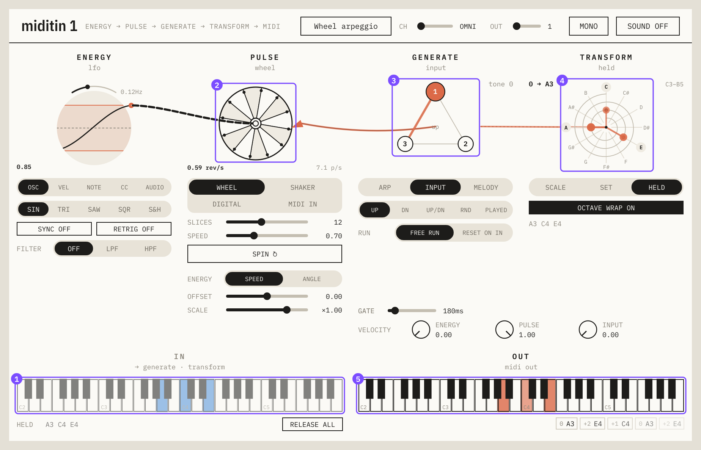

What you see, following the numbers:

1. **The held notes** light up blue on the IN keyboard.
2. **The wheel spins.** Each peg that passes the pointer on its right is a *pulse*.
3. **Each pulse steps the arpeggio** to its next node. By default the arpeggio is made of your
   held notes, lowest first.
4. **The transform** maps that step to a real note and flashes a line to it.
5. **The note comes out**, lit orange on the OUT keyboard and sent as MIDI.

The wheel's speed rises and falls with the **energy** curve on the far left, so the arpeggio
speeds up and slows down by itself. That is the whole idea: everything else in the plugin changes
*what* drives the pulses, *how* they happen, *which steps* they play and *which notes* those
steps become.

**Make it yours.** Try these one at a time, while holding a chord:
- PULSE → **DIGITAL**: the pulses lock to the tempo grid.
- GENERATE → **MELODY**: a 16-step melody instead of an arpeggio.
- TRANSFORM → **SCALE**: the steps play a scale instead of your held notes.
- ENERGY → **VEL**: play harder for a faster wheel.

---

## 2. The window at a glance

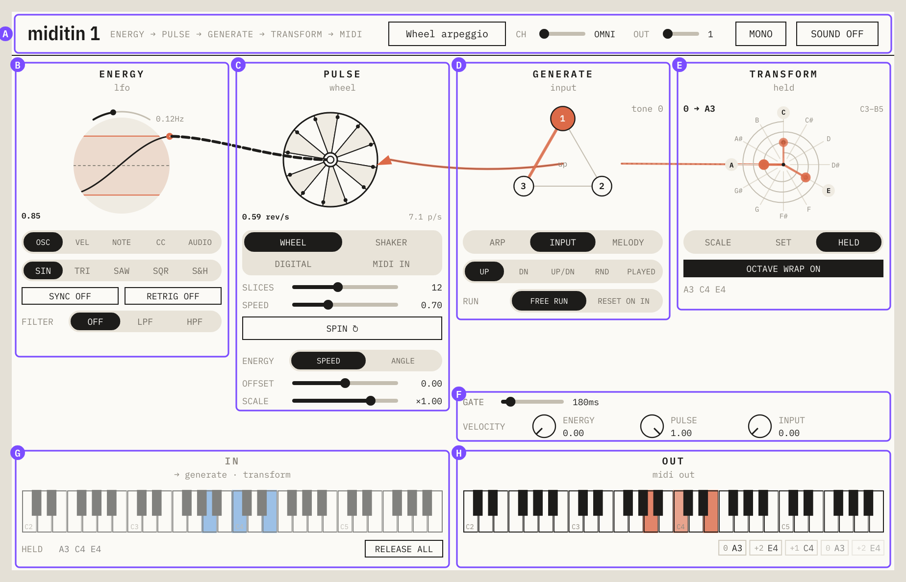

| | Area | What it is |
|---|------|------------|
| **A** | Header | Preset name, MIDI channels, MONO/POLY, and the preview synth. See [§4](#4-header). |
| **B** | ENERGY | The energy curve and what it follows. See [§5](#5-energy). |
| **C** | PULSE | What makes the pulses, and how energy moves it. See [§6](#6-pulse). |
| **D** | GENERATE | The arpeggio or melody each pulse steps through. See [§7](#7-generate). |
| **E** | TRANSFORM | How steps become notes. See [§8](#8-transform). |
| **F** | Gate and velocity | How long and how loud the output notes are. See [§9](#9-in-and-out). |
| **G** | IN | What is coming in, and a keyboard to play from. See [§9](#9-in-and-out). |
| **H** | OUT | What is going out. See [§9](#9-in-and-out). |

Each module has its title and current kind on top, an animation in the middle, and its controls
below. Only the controls that matter for the current choice are shown: pick SHAKER and the wheel's
controls make way for the shaker's.

**Controls:**
- **Segmented buttons** (the rounded pills) pick one option.
- **Sliders**: click or drag along the track. **Double-click** resets to the default.
- **Knobs** (velocity): drag up or down.
- Some animations are controls too: the energy plot, the melody grid and the transform wheel.

**The window resizes** from its bottom-right corner, from 75% to 250%, keeping its shape. The size
is remembered for every miditin 1 window on the machine.

---

## 3. How the chain works

The modules are read left to right, in the order the signal flows:

**ENERGY → PULSE → GENERATE → TRANSFORM → MIDI OUT**

- **Energy** is one number between 0 and 1 that moves over time: an LFO, or something you play
  (velocity, pitch, a controller, an audio level).
- **Pulse** is a moment in time. Energy pushes the pulse maker, and each pulse carries a
  **strength** from 0 to 1 (how fast the wheel spun, how hard a ball hit the wall).
- **Generate** advances one step per pulse and emits a **tone**: a plain number like 0, +2 or −1.
  Tones are not notes yet. "+2" means "two steps up from the start", whatever the steps are.
- **Transform** decides what the steps are. In a scale, tone +2 is the third note of the scale. On
  your held notes, tone +2 is the third held note from the bottom. The same melody therefore
  plays in C major, in a whole-tone scale or on the chord you are holding, without being
  rewritten.

The lines between the animations show the flow. The cable from energy to pulse moves faster and
gets thicker with more energy. The wire from pulse to generate and the dotted line from generate
to transform flash orange each time something passes through them.

**Two rules hold everywhere:**
- **No input, no output.** Pulses only step the generator while at least one note is held. The
  wheel keeps turning and the balls keep bouncing on screen, but nothing plays.
- **Input notes are used, not passed on.** Your held notes drive the plugin; only the generated
  notes go out. Everything else you send (controllers, pitch bend, pressure, program changes)
  passes straight through.

---

## 4. Header

| | Control | What it does |
|---|---------|--------------|
| **1** | Title | Hover over it to see which build is loaded (commit and date) in place of the caption. Click to copy that to the clipboard, for bug reports. |
| **2** | Caption | The chain, as a reminder of the reading order. |
| **3** | Preset | The name of the open preset. Click to open the preset librarian; click again to close it. See [§11](#11-presets). |
| **4** | CH | Which MIDI channel is played. **OMNI** (the default) plays notes from every channel. A number plays only that channel's notes, and every other channel passes through untouched, so one miditin 1 can sit in a busy MIDI stream. Output goes out on CH. |
| **5** | OUT | Only shown in MONO with CH on OMNI: the output channel. (In POLY, each voice's notes go out on the channel its input note came in on.) |
| **6** | MONO / POLY | One machine for everything, or one machine per held note. See [§10](#10-mono-and-poly). |
| **7** | SOUND | The built-in preview synth, a simple triangle voice on the plugin's audio output. Off by default: the product is the MIDI. |

---

## 5. ENERGY

Energy is the slow hand on the controls. It is drawn as a curve inside a soft circle: time moves
from left to right, and the dot on the right edge is the value right now. That dot is where the
cable to PULSE starts.

### The oscillator

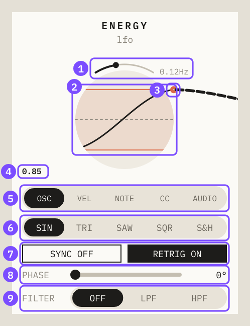

| | Control | What it does |
|---|---------|--------------|
| **1** | Rate arc | The bent slider over the circle. **Drag left/right** to set the speed: **RATE** in Hz (0.02–3 Hz, default 0.12 Hz), or with SYNC on, **CYCLE**, the length of one cycle in bars (4 bar … 1/32, default 1 bar). |
| **2** | Range band | The shaded band between the two orange lines is the range the energy moves in. **Drag inside the band** to move it up or down (CENTER). **Drag the top or bottom line** to widen or narrow it (DEPTH). Default: centre 0.5, depth 0.7, so energy swings between 0.15 and 0.85. |
| **3** | Output dot | The current energy, leaving for PULSE. |
| **4** | Readout | The current value. In POLY, "×3" means three voices each have their own curve. |
| **5** | Source | What the energy follows (below). |
| **6** | Shape | Oscillator shape: **SIN**, **TRI**, **SAW**, **SQR**, **S&H** (sample and hold: a new random level each cycle). |
| **7** | SYNC / RETRIG | **SYNC** locks the cycle to the tempo (the DAW's, while it plays). **RETRIG** restarts the cycle when you play a note. |
| **8** | PHASE | With RETRIG on: where in the cycle a restart begins (0–360°). |
| **9** | FILTER | Smooths or differentiates the energy (below). |

**LEGATO** (next to RELEASE ALL under the IN keyboard) decides what "when you play a note" means
for RETRIG. **On** (the default): the cycle restarts only on the first note of a phrase; notes
played while another is still held continue it. **Off**: every note restarts it.

### Sources

| Source | Energy follows | Good for |
|--------|----------------|----------|
| **OSC** | The oscillator above. | Motion that runs by itself. |
| **VEL** | The velocity of the note you play. Drops to 0 when you let go. | Play harder for more. |
| **NOTE** | The pitch of the note you play, C2 → 0 up to C7 → 1. | Higher notes run faster, or slower. |
| **CC** | A MIDI controller (below). | A mod wheel, an expression pedal, a knob. |
| **AUDIO** | The loudness of audio fed into the plugin's input (below). | Reacting to a drum loop or a voice. |

Whatever the source, CENTER and DEPTH still apply: the source's 0..1 is squeezed into the band.

### Filter: smoothing and change

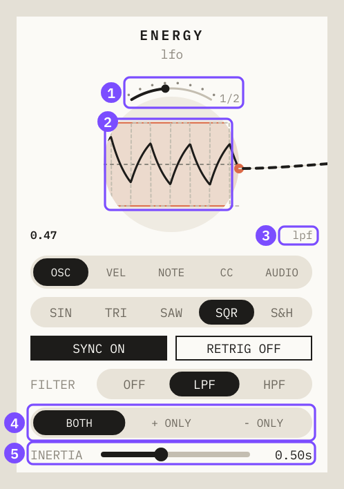

| | Control | What it does |
|---|---------|--------------|
| **1** | Rate arc, synced | With SYNC on, the dots along the arc mark the eight cycle lengths. Here: 1/2 bar. |
| **2** | Filtered vs input | With a filter on, the dashed line is what goes in and the solid line is what comes out. |
| **3** | Readout tag | The source and filter in short: `lpf`, `hpf+`, `cc74 lpf-`… |
| **4** | Edges | **BOTH**, **+ ONLY** or **− ONLY**: which direction the filter acts on. The other direction passes straight through. |
| **5** | INERTIA / WINDOW | The filter's time, 0.02–3.02 s (default 0.29 s). |

- **OFF**: energy is the source as it is.
- **LPF** (inertia) smooths changes, like a heavy flywheel. Use it to make a jumpy source (S&H,
  VEL, a twitchy controller) glide. **− ONLY** with LPF means rises are instant and falls are
  slow: a note's velocity jumps the energy up, then lets it sink away.
- **HPF** (rate of change) reacts to *movement* instead of level. A controller held still leaves
  the energy resting on its zero line; moving it pushes the energy away from it. WINDOW sets how
  long a change counts.

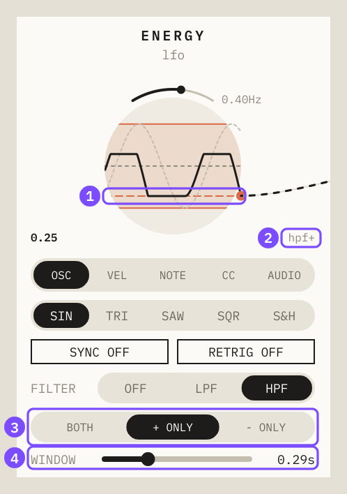

| | Control | What it does |
|---|---------|--------------|
| **1** | Zero line | With HPF, the dashed orange line is where the output rests when nothing changes. **Drag it** up or down. |
| **2** | Readout tag | `hpf+`: HPF, rises only. |
| **3** | Edges | Here **+ ONLY**: only rises register, so a rising sine pushes the energy up and a falling one leaves it at rest. |
| **4** | WINDOW | How long the filter looks back. |

### CC and LEARN

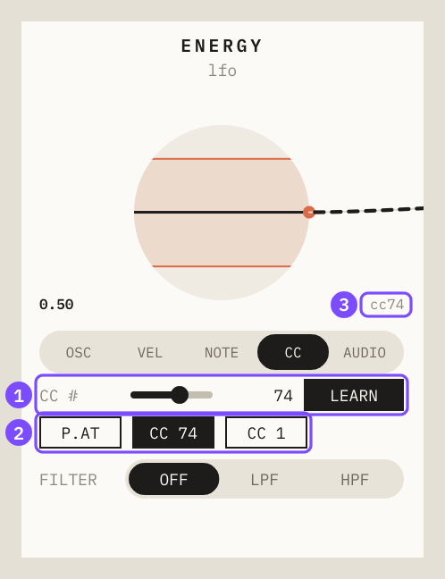

| | Control | What it does |
|---|---------|--------------|
| **1** | CC # and LEARN | The controller number (0–119), or **AT** (channel pressure), **BEND** (pitch bend) or **P.AT** (polyphonic aftertouch). Click **LEARN**, move a controller, and it is offered below. LEARN reads LISTEN until something moves. |
| **2** | Picks | The controllers that moved most recently. Click one to use it. |
| **3** | Readout tag | The controller in use. |

With **P.AT** in POLY, each voice follows the pressure of its own key.

### AUDIO

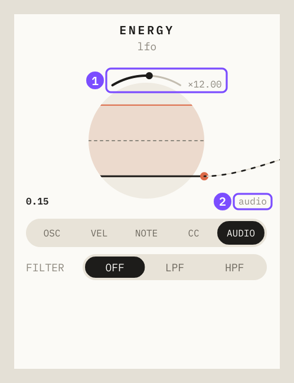

| | Control | What it does |
|---|---------|--------------|
| **1** | GAIN arc | With AUDIO, the arc over the circle sets the gain (×1–×100, default ×1). Quiet material needs more. The level is clamped at 1. |
| **2** | Readout tag | `audio`. |

The plugin's audio input is measured, never passed through. In a DAW, put audio on miditin 1's
track (or send to its input). The JUCE standalone mutes its input by default to avoid feedback:
untick that in its audio settings.

---

## 6. PULSE

The pulse maker decides *when* the generator steps. Pick it from **WHEEL**, **SHAKER**,
**DIGITAL** or **MIDI IN**.

**How energy moves it.** Each of the first three has a *core* value (wheel speed, shaking
strength, grid division) that energy scales:

> core × (**OFFSET** + **SCALE** × energy)

With the defaults (OFFSET 0, SCALE ×1), energy 0 stops the pulse maker and energy 1 runs it at its
core value. Raise OFFSET to keep it going at zero energy. A negative SCALE turns it around, so more
energy means slower. Each pulse maker keeps its own OFFSET and SCALE (OFFSET −1…1, SCALE
×−2…×2).

### Wheel

A wheel of fortune. Each peg passing the pointer is a pulse, stronger the faster the wheel spins.

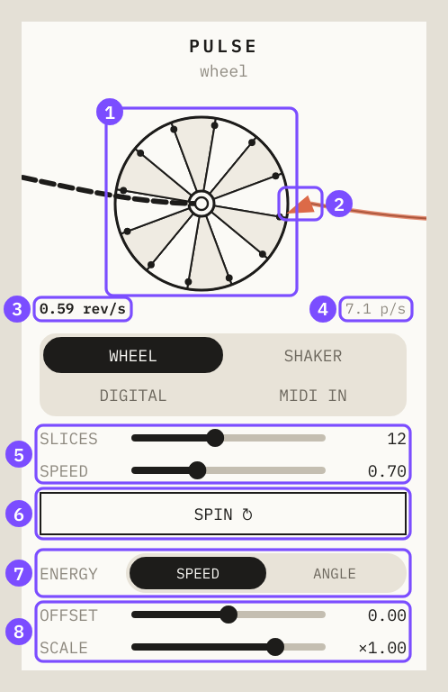

| | Control | What it does |
|---|---------|--------------|
| **1** | Wheel | Turns with energy. In POLY, each voice's wheel is drawn over the others. |
| **2** | Pointer | The flick at 3 o'clock. A peg passing it is a pulse. |
| **3** | rev/s | How fast the wheel turns right now. |
| **4** | p/s | Pulses per second: rev/s × slices. |
| **5** | SLICES / SPEED | Pegs on the wheel (3–24, default 12), and the core speed in revolutions per second (0.05–2, default 0.7). |
| **6** | SPIN ↻ | A push by hand: the wheel speeds up and settles back in about a third of a second. |
| **7** | ENERGY | **SPEED**: energy is how fast the wheel spins. **ANGLE**: energy is where the wheel *points*; the wheel springs to that angle (the slider reads **TURNS**), so pegs pass only while the energy is moving. A slow sine rocks it back and forth; a square wave flicks it. |
| **8** | OFFSET / SCALE | See above. |

The wheel has no weight: it follows energy instantly. For a wheel that winds up and runs down,
put an LPF on the energy.

### Shaker

A round box of balls. Energy shakes the box; **only hits on the wall are pulses**, and a harder
hit is a stronger pulse. Balls also bounce off each other, but that makes no pulse.

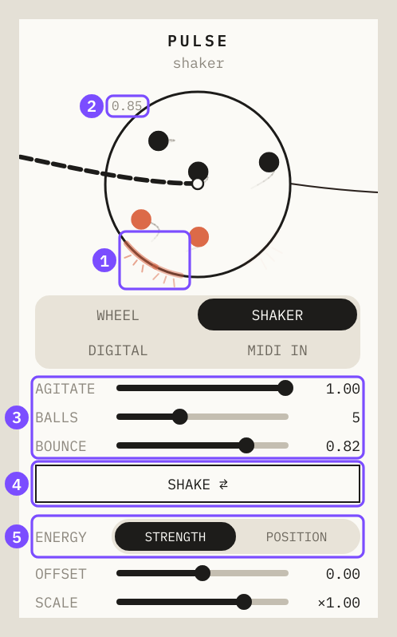

| | Control | What it does |
|---|---------|--------------|
| **1** | Wall hits | Each hit flashes orange on the rim where it happened. |
| **2** | Agitation | How hard the box is being moved right now. |
| **3** | AGITATE / BALLS / BOUNCE | Core shaking strength (0–1, default 1), number of balls (1–12, default 5), and how bouncy they are (0.3–0.98, default 0.82). More balls, more hits. Less bounce, the balls settle quicker. |
| **4** | SHAKE ⇄ | One jolt of the box in a random direction. |
| **5** | ENERGY | **STRENGTH**: energy is how hard a hand shakes the box (about four times a second). **POSITION**: the box *rides* the energy curve up and down, so only changes stir the balls. A slow sine barely moves them; a square edge or an S&H jump throws them against the wall. |

Very hard shaking pins the balls to the wall and the pulses thin out, as a real shaker does.

### Digital

A beat grid. Pulses fall exactly on the grid, at the tempo of the DAW (or 112 BPM when there is
none). Energy picks the grid row: more energy, finer division.

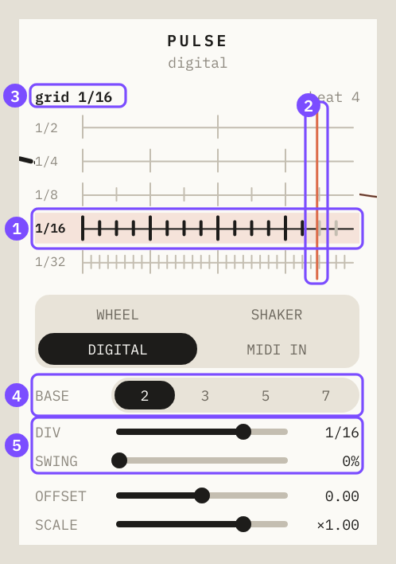

| | Control | What it does |
|---|---------|--------------|
| **1** | Active row | The row energy picked right now, highlighted. Each row shows one bar. |
| **2** | Playhead | Where in the bar we are. |
| **3** | Readout | The active grid and the beat. |
| **4** | BASE | The grid family: **2** (1/2, 1/4, 1/8, 1/16, 1/32), **3** (triplets: 1/3 … 1/48), **5** (quintuplets) or **7** (septuplets). |
| **5** | DIV / SWING | **DIV** is the finest row energy can reach (default: the finest). **SWING** (0–60%) delays every other step, at 1/16 and finer, base 2 only. |

The row is DIV × (OFFSET + SCALE × energy), rounded. With the defaults, low energy plays half
notes and full energy plays the DIV row. Pulses on the beat are stronger than pulses between beats.

### MIDI in

No pulse maker: you are the pulse. **SOURCE** picks how.

- **NOTES**: every note you play is one pulse. Hold a chord in TRANSFORM HELD and play a rhythm
  with one finger, or step a melody one key press at a time.
- **CLOCK**: pulses follow MIDI clock, at a division of it.

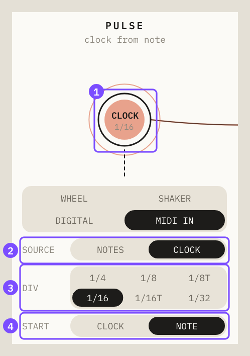

| | Control | What it does |
|---|---------|--------------|
| **1** | Clock | Lights on each pulse. Shows the division. |
| **2** | SOURCE | **NOTES** or **CLOCK**. |
| **3** | DIV | Pulses per clock: **1/4**, **1/8**, **1/8T**, **1/16** (default), **1/16T**, **1/32**. |
| **4** | START | **CLOCK**: count from the clock's own start (a MIDI Start message, or the DAW's bar), so pulses sit on the song's grid. **NOTE**: count from the moment you press a note; that note is the first pulse. Runs even with the DAW stopped. |

VST3 hosts do not send MIDI clock to plugins. Inside a DAW, CLOCK therefore follows the DAW's
playhead instead, and only while the transport is playing. START = NOTE needs neither. The
standalone receives real clock from a MIDI device.

---

## 7. GENERATE

The generator takes one step per pulse and emits a tone. Pick **ARP**, **INPUT** or **MELODY**.

### Arp

An arpeggio of tones you type.

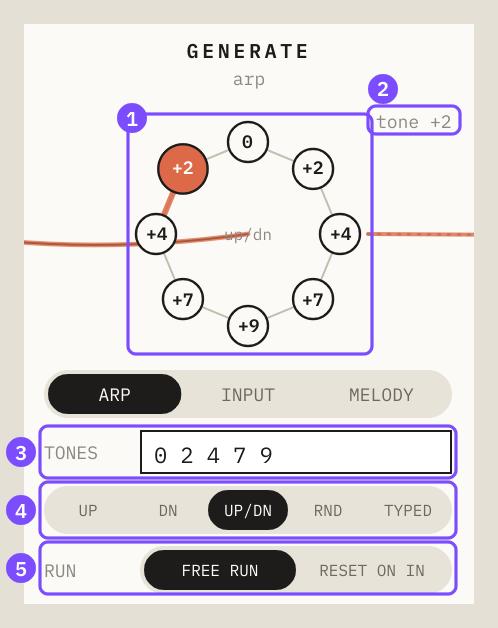

| | Control | What it does |
|---|---------|--------------|
| **1** | Nodes | The arpeggio in play order. The orange node is the current step; the order is written in the middle. |
| **2** | Tone readout | The tone just played. |
| **3** | TONES | Type the tones, separated by spaces or commas: `0 2 4 7 9`, `-3 0 5`. Up to 16, each from −24 to +24. |
| **4** | Order | **UP**, **DN** (down), **UP/DN** (up then down, without repeating the ends), **RND** (random), **TYPED** (as you typed them). |
| **5** | RUN | **FREE RUN** keeps going from where it was. **RESET ON IN** starts again from the first step on every note you play. |

Remember that tones are steps, not semitones: in a scale, `0 2 4` is a triad; on held notes, it
is the first, third and fifth held note.

### Input

The arpeggio is built from the notes you hold. Four held notes give four steps.

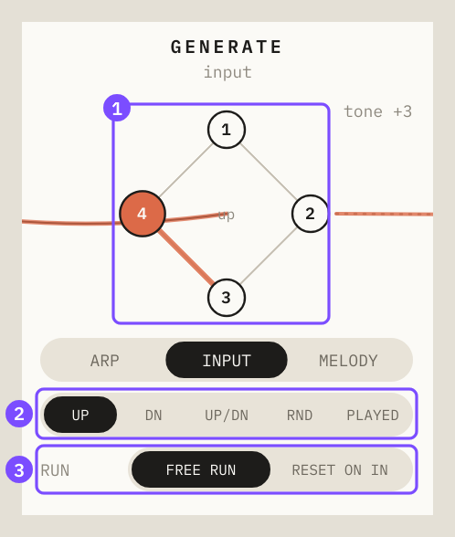

| | Control | What it does |
|---|---------|--------------|
| **1** | Nodes | One per held note, numbered from 1 (lowest) up. |
| **2** | Order | As for ARP, except the last option is **PLAYED**: the order you pressed the keys. |
| **3** | RUN | As for ARP. |

Each step's tone is the held note's position from the bottom (0, 1, 2…). With TRANSFORM on HELD
(the default) that plays your notes as they are. With TRANSFORM on SCALE, the same steps walk up
the scale instead, so the chord shape sets the rhythm of the pattern and the scale sets the notes.

In POLY, each voice's input arpeggio is a single step, labelled **1**: "this note".

### Melody

A 16-step melody grid. Each pulse moves one step.

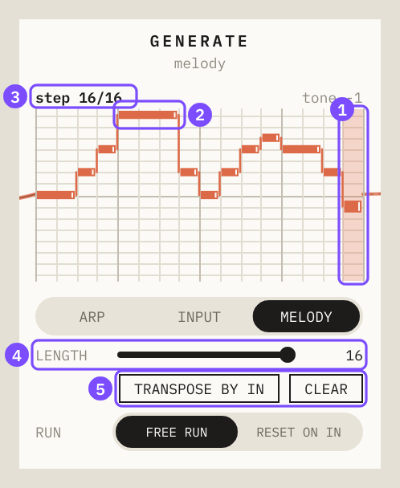

| | Control | What it does |
|---|---------|--------------|
| **1** | Playhead | The current step. |
| **2** | A held note | A note that lasts several steps. The small tab at its right end is its **handle**. |
| **3** | Readout | Step number and the tone just played (or "rest"). |
| **4** | LENGTH | How many steps loop (2–16). |
| **5** | TRANSPOSE BY IN / CLEAR | See below. CLEAR empties the grid. |

**Editing the grid.** Rows are tones from +7 (top) to −7 (bottom); the darker middle line is 0.
- **Click** an empty step to put a one-step note there. **Drag** across to draw a line of them.
- **Click** a note to remove it.
- **Drag a note's handle** to the right to make it longer, or left to shorten it. Drawing never
  makes long notes; only the handle does.

A long note sends one note-on, holds through its steps and lets go one GATE time after its last
step. Empty steps are rests.

**TRANSPOSE BY IN** moves the whole melody so that tone 0 lands on the note you play. In MONO the
most recent held note sets it; in POLY each voice uses its own. Play a C and the melody starts on
C; play an E and the same melody starts on E, still in the transform's scale.

---

## 8. TRANSFORM

The transform turns tones into MIDI notes. It is the same for every voice. Pick **SCALE**,
**SET** or **HELD**.

All three draw a **12-note wheel** with C at the top. With OCTAVE WRAP on, it is a spiral of three
octaves, low at the centre; with it off, a single circle. Dots mark the notes the transform can
play. Each new note flashes a line from the centre to where it landed.

### Scale

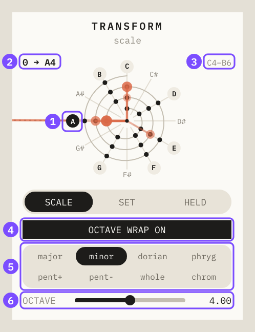

| | Control | What it does |
|---|---------|--------------|
| **1** | Root | The dark note name. **Click a note name on the wheel** to make it the root. |
| **2** | Mapping readout | The last tone and the note it became: `0 → A4`. |
| **3** | Range | The notes the spiral shows. |
| **4** | OCTAVE WRAP | See [Octave wrap](#octave-wrap). |
| **5** | Scale | major, minor (default), dorian, phrygian, pentatonic major (**pent+**), pentatonic minor (**pent−**), whole tone, chromatic. |
| **6** | OCTAVE | The octave tone 0 sits in (1–7, default 4). With root A and octave 4, tone 0 is A4. |

### Set

Your own collection of notes.

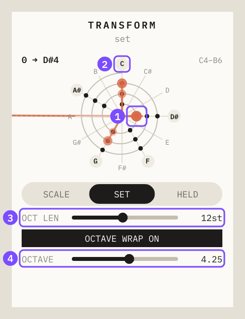

| | Control | What it does |
|---|---------|--------------|
| **1** | Border note | The orange tick marks where the set starts: tone 0. |
| **2** | Note names | **Click a note name** to add it to the set or remove it. |
| **3** | OCT LEN | How far apart the set repeats, in semitones (1–24, default 12). Set it to something other than 12 for scales that do not repeat at the octave: OCT LEN 5 with one note repeats every fourth. |
| **4** | OCTAVE | In set mode this moves in semitone steps (4.25 = a quarter of the way up octave 4, three semitones above C4). It transposes the set and moves the border note with it. |

### Held

The notes you are holding are the scale: tone 0 is your lowest held note, tone 1 the next, and so
on.

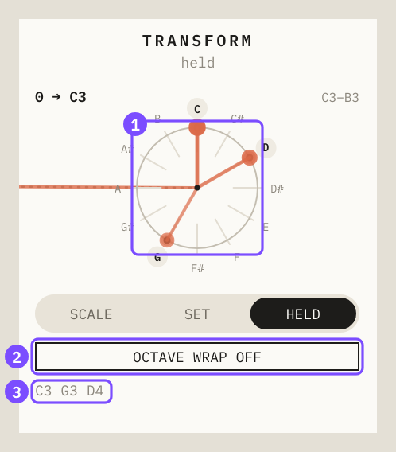

| | Control | What it does |
|---|---------|--------------|
| **1** | Wheel | Your held notes are marked. Here OCTAVE WRAP is off, so the wheel is a single circle. |
| **2** | OCTAVE WRAP | See below. |
| **3** | Held notes | The notes the transform is using. |

### Octave wrap

What happens when a tone goes past the last note:
- **On** (default): it carries on into the next octave (or the next OCT LEN, in SET). Holding
  C E G, tone 3 is the C an octave up.
- **Off**: it folds back into the same octave. Tone 3 is the C you hold.

---

## 9. IN and OUT

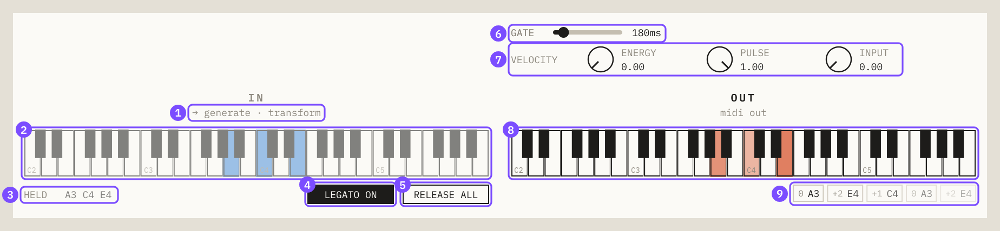

| | Control | What it does |
|---|---------|--------------|
| **1** | Feeds | What your input is doing right now: driving the **pulse** (MIDI IN), the **generate** stage (INPUT), a **reset** (RESET ON IN), the **transform** (HELD), or **nothing** except starting and stopping the machine. |
| **2** | IN keyboard | Held notes are blue, wherever they come from. **Click a key** to latch it; click again to let go. Click lower on a key for a louder note. |
| **3** | HELD | The held notes by name. |
| **4** | LEGATO | Only shown when it does something (RETRIG on, or CLOCK START = NOTE). On: a note played under another held note continues the LFO and the note clock instead of restarting them. |
| **5** | RELEASE ALL | Lets go of every held note, including latched ones. |
| **6** | GATE | How long each output note lasts, 30–1200 ms (default 180 ms). |
| **7** | VELOCITY | Where output velocity comes from: **ENERGY** (the energy when the pulse happened), **PULSE** (the pulse's strength) and **INPUT** (the velocity of the note you play). The three are added, so set one to 1 and the others to 0 to pick a single source. Default: pulse strength only. |
| **8** | OUT keyboard | The notes going out, brighter for louder. |
| **9** | Recent notes | The last few notes out, newest on the left: tone, then note. |

The IN keyboard is muted on purpose. It is a utility for trying things without a controller; the
output is what counts.

---

## 10. Mono and poly

**MONO** runs one machine for everything: one energy curve, one pulse maker, one generator. The
notes you hold steer it.

**POLY** gives every held note its own machine: its own energy curve, its own wheel or balls or
grid, its own generator. Each voice starts when you press its key and stops when you let go, up to
16 at once. The transform stays shared.

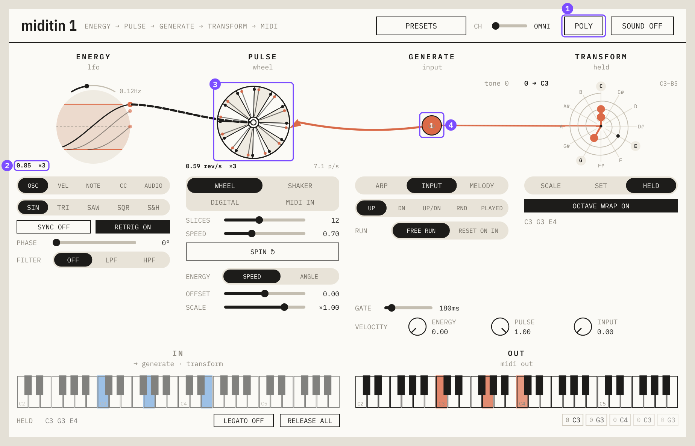

| | What | |
|---|---|---|
| **1** | POLY | The header button. |
| **2** | Readout | "×3": three voices, each with its own curve in the plot. |
| **3** | Stacked wheels | Each voice's wheel drawn on top of the others, turning at its own speed. The shaker shares one box with every voice's balls; the digital grid lights each voice's row. |
| **4** | One step | In POLY, an INPUT arpeggio is the voice's own note, a single step. |

In POLY, **tone 0 is the voice's own note**. A typed arpeggio `0 2 4` played from C and from F
gives a triad on C and a triad on F, each in the transform's scale. With **RETRIG** on, each key
starts its curve fresh, so keys pressed at different times drift apart, as in the picture.

---

## 11. Presets

Click the preset name in the header to open the librarian; click it again to close it.

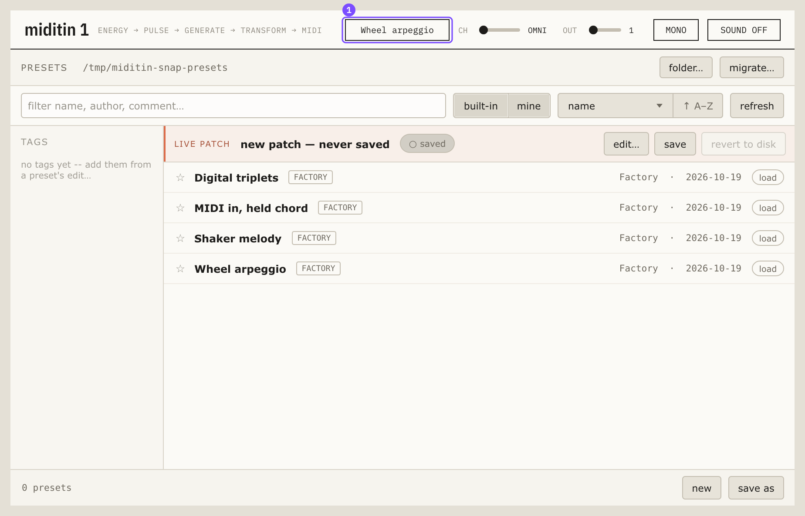

- **load** loads a preset. Clicking a row only selects it, so browsing never changes what you
  hear. If the current patch has unsaved changes, you are asked first.
- **save** writes the open preset; **save as** saves a copy under a new name; **new** starts from
  the defaults.
- **The star** marks a favourite. **Tags** (added with **edit…**) appear in the rail on the left;
  click one to filter by it.
- **folder…** points the librarian at another folder; **migrate…** moves your presets there.
- The **FACTORY** presets are built in and cannot be changed; duplicate one to edit it.

A preset stores everything: every choice, every slider, the typed arpeggio, the melody and the set.
Presets are files ending in `.miditin` in the presets folder (by default
`~/.config/Autotel/MIDITIN_1/Presets`). A preset's name is its file name.

**Factory presets:**

| Preset | What it is |
|--------|-----------|
| Wheel arpeggio | The defaults: the wheel paces an arpeggio of your held notes. |
| Shaker melody | A slow triangle LFO shakes four balls through the melody, in A minor. |
| Digital triplets | A synced LFO moves a triplet grid; an up/down arpeggio in D dorian. |
| MIDI in, held chord | POLY, each key you play is one step of `0 1 2 4`, in A minor pentatonic. |

---

## 12. Recipes

Start each from **Wheel arpeggio** and hold a chord.

- **Play harder, play faster.** ENERGY → **VEL**, FILTER **LPF** with **− ONLY** and INERTIA around
  1 s. A hard note spins the wheel up; it slows as the energy sinks.
- **Mod wheel picks the subdivision.** ENERGY → **CC**, LEARN, move the mod wheel. PULSE →
  **DIGITAL**. Drag the range band's lines to the top and bottom of the circle so the wheel's
  whole travel reaches the whole grid: mod wheel down plays half notes, up plays 1/32.
- **Strums from jumps.** PULSE → **SHAKER**, ENERGY → **POSITION**. ENERGY shape **S&H**, RATE
  about 1 Hz. Each new random level throws the balls and makes a burst of notes, then it settles.
- **A melody that follows your hand.** GENERATE → **MELODY**, **TRANSPOSE BY IN** on. TRANSFORM →
  **SCALE**. PULSE → **MIDI IN**, SOURCE **NOTES**. Each key you press is one step of the melody,
  starting from the key you played.
- **Echoing chords.** **POLY**, PULSE **WHEEL**, ENERGY **RETRIG** on, LEGATO off. Each finger
  gets its own wheel, so a chord played as a slow roll comes back as interlocking patterns.
- **Drums drive the arpeggio.** ENERGY → **AUDIO**, FILTER **LPF** around 0.3 s, GAIN up until
  the curve fills the band. Feed a drum loop into miditin 1's input: busy bars spin the wheel faster.
- **A rhythm that only moves when you move.** PULSE **WHEEL**, ENERGY mode **ANGLE**, ENERGY → **CC**.
  The wheel turns only while the controller moves; holding still is silence.

---

## 13. Tips and troubleshooting

**Nothing comes out.**
- Is a note held? Nothing plays without one (the IN keyboard shows them in blue).
- CH set to a channel your controller is not on? Set it back to **OMNI**.
- PULSE **MIDI IN** with **CLOCK** and START **CLOCK** needs the DAW playing. Try START **NOTE**.
- PULSE energy at zero? With OFFSET 0, energy 0 stops the wheel and the shaker. Raise OFFSET or
  the energy's CENTER.
- GENERATE **ARP** with nothing typed ("type tones, e.g. 0 2 4"), a melody of only rests, or
  TRANSFORM **SET** with no notes ("empty").
- In a DAW: is the synth track actually receiving miditin 1's MIDI output?

**I hear nothing in the standalone.** It sends MIDI. Choose a MIDI output in its settings, or turn
on **SOUND** to hear the preview synth.

**AUDIO energy stays at zero.** No audio reaches the plugin's input. In the standalone, untick the
input mute in its audio settings. In a DAW, put the audio on miditin 1's own track or route it to
its input.

**Notes come out very quietly.** Velocity is the sum of the three VELOCITY knobs; with all three
at 0 every note has velocity 1.

**Stuck notes.** miditin 1 releases every note it started when you stop the transport, bypass it,
change a structural choice or remove it. RELEASE ALL lets go of latched keys on the IN keyboard.

**The wheel is turning but no notes come out.** The animations keep running so you can see the
machine, but pulses only reach the generator while a note is held.

**Which version is this?** Hover over the "miditin 1" title; click it to copy the build to the
clipboard.

**The same input always gives the same output.** The physics are simulated deterministically, so a
recorded performance plays back identically. Only the AUDIO source can differ slightly between
sample rates.

---

## 14. Automation reference

The sliders and knobs are DAW parameters and can be automated. The **choices** (anything picked
with a segmented button or toggle, the typed tones, the melody, the set, the CC number, the
channels) are not: changing them reshapes the machine and would cut notes off mid-performance.
They are saved with the project and in presets.

| Parameter | Range | Default |
|-----------|-------|---------|
| Energy rate | 0.02–3 Hz | 0.12 Hz |
| Energy sync cycle | 4 bar … 1/32 | 1 bar |
| Energy center | 0–1 | 0.5 |
| Energy depth | 0–1 | 0.7 |
| Energy filter time | 0.02–3.02 s | 0.29 s |
| Energy start phase | 0–360° | 0° |
| Energy HPF zero | 0–1 | 0.5 |
| Energy audio gain | ×1–×100 | ×1 |
| Wheel speed | 0.05–2 rev/s | 0.7 |
| Wheel slices | 3–24 | 12 |
| Shaker agitation | 0–1 | 1 |
| Shaker balls | 1–12 | 5 |
| Shaker bounce | 0.3–0.98 | 0.82 |
| Digital grid division | 5 rows | finest |
| Digital swing | 0–60% | 0% |
| Wheel / Shaker / Digital energy offset | −1–1 | 0 |
| Wheel / Shaker / Digital energy scale | ×−2–×2 | ×1 |
| Melody length | 2–16 | 16 |
| Transform octave | 1–7 | 4 |
| Transform octave length | 1–24 semitones | 12 |
| Gate | 30–1200 ms | 180 ms |
| Velocity from energy / pulse / input | 0–1 | 0 / 1 / 0 |
| Tempo without host | 60–200 BPM | 112 |

*Tempo without host* has no control in the window: it is the tempo used when the DAW does not
provide one.
